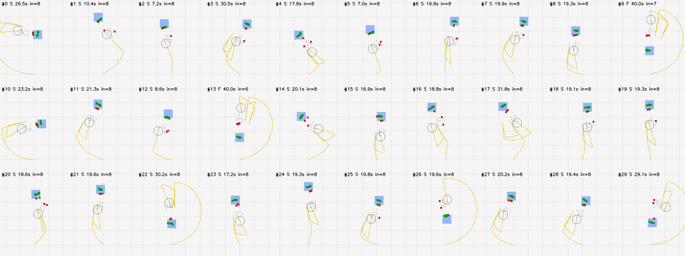
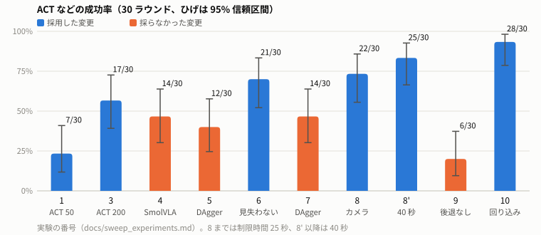

# LeKiwi の箒掃除タスク: シミュレーションでの模倣学習

2026-11-02

## 1. 概要

台車とアームを持つロボット LeKiwi（3 輪のオムニホイールの台車と SO101 アーム）に手箒を持たせ、床に散らばったゴミを目標の領域へ掃き集めるタスクを、シミュレーションの中で模倣学習させた。

- **タスク**: 2〜3cm のゴミ 10 個を、床の上の 30cm 角の目標領域（色付きの正方形）へ掃き集める。8 個以上が入れば成功、制限時間は 40 秒である。ゴミと目標領域の位置は毎回ランダムに決まる。
- **ポリシーの入力**: front（台車）と wrist（手首）の 2 台のカメラの画像（320×240）と、自分の関節の状態だけである。ゴミの位置などの真値は見ない。
- **ポリシーの出力**: アームの関節位置（5 + グリッパ 1）と台車の速度（3）の 9 次元である。実機の LeRobot の LeKiwi と同じキー名と単位にそろえた。
- **環境**: Isaac Sim 5.1、IsaacLab 2.3、LeIsaac 0.4.0、LeRobot 0.4.2。すべて Docker で動かす。GPU は RTX 5070（12GB）1 枚である。
- **結果**: 真値を使う計画器でデモを自動生成し、ACT を学習した。成功率は 7/30 から始まり、最終的に **28/30（93%、95% 信頼区間 79〜98%）** になった。

## 2. 目的

1. **台車の移動を含むタスクに、模倣学習や VLA を適用する。** 机の上で完結する把持のタスクと違い、台車で動きながら道具を使うタスクで何が難しいのかを確かめる。
2. **Isaac Sim を含むローカルの Docker 環境を整える。** シミュレーション、推論、学習を 1 台の PC で再現できる形で回せるようにする。

### タスクの選び方

清掃専用のロボット（ロボット掃除機など）ではなく、汎用のロボットに清掃をさせる場面を想定した。汎用のロボットは、人と同じ道具を手に持って作業することになる。そこで、専用の吸引機構などは付けず、一般的な手箒（全長 30cm、ブラシの幅 20cm）をグリッパに持たせた。掃く動作は、アームで穂を床に当てる動きと、台車でゴミを押し運ぶ動きの組み合わせになり、移動を含むタスクの題材として適している。

## 3. 環境の構成

### Docker のイメージ

用途ごとに 3 つのイメージに分けた（Docker の multi-stage ビルド）。

| イメージ | 中身 | 役割 |
|---|---|---|
| sim | Isaac Sim 5.1、IsaacLab、LeIsaac | シミュレーション、デモの生成、評価 |
| gr00t | GR00T N1.5 | 推論サーバ（LeIsaac の既存のタスクで使用） |
| train | LeRobot 0.4.2 | データの変換、学習（ACT、SmolVLA）、推論サーバ |

- **依存の衝突を、イメージを分けて避けた。** たとえば、sim と GR00T は gymnasium と protobuf の要求するバージョンが合わない。LeRobot も、Isaac Sim が固定している numpy と衝突するおそれがあるので、sim には入れない。各イメージの間は ZMQ で通信する。
- **再現性を保つ。** Python の依存はロックファイル（uv）で固定し、外部のアセットは取得元とハッシュで検証する。上流（LeIsaac）のコードは変更せず、自前のタスクは外から登録した。
- **12GB の VRAM に収める。** 物理演算は CPU で行い、テクスチャの予算を絞った。GR00T は推論で使わない層を外した。
- **操作をコマンドにまとめた。** 生成、変換、学習、評価をそれぞれ 1 つのコマンドで実行できる。動作確認も 1 つのコマンドで、起動、既存タスクの推論、箒のタスク、学習環境までを通して合否を出す。

### 処理の流れ

```
計画器（sim の真値を使う）──生成──▶ HDF5（成功したエピソードだけ）
        ──変換──▶ LeRobot 形式（30fps、動画）
        ──学習──▶ ACT など（ローカル。大きいモデルは Colab）
        ──推論サーバ（ZMQ）──▶ sim で 30 ラウンドの評価（成功率、図、動画、状態の記録）
```

## 4. 工夫した点

### 4.1 真値を使う計画器でデモを自動生成した

人がテレオペでデモを集める代わりに、sim の真値（ゴミの位置、目標領域、台車の姿勢）を使う古典的な計画器を作った。

- 動き方: ゴミのまとまりの、目標とは反対側へ回り込み、穂を床に当てたまま、台車で目標の方向へ押す。これを繰り返す。
- 計画器自体の成功率は 30/30 である。成功したエピソードだけを学習データに残す。
- 200 エピソードの生成にかかる時間は約 67 分である。

### 4.2 評価を 1 つの仕組みにそろえ、統計で判断した

- 計画器も学習したポリシーも、同じ評価の仕組みで評価する。ポリシーは推論サーバとして動かし、sim から ZMQ でつなぐ。
- 配置はシードで固定し、すべての条件を同じ 30 個の配置で比べる。
- 成功率には 95% 信頼区間（Wilson）を付ける。条件の差は Fisher の正確検定で判断する。1 回の結果だけで「良くなった」とは結論しない。

### 4.3 失敗を見える形にした

- 全ラウンドの台車の軌跡とゴミを上から描いた図（下の図）を作った。
- 動画と、毎フレームの状態（台車の姿勢、ゴミの位置、関節、計画器の段階）も記録した。
- これらで失敗を型に分けた。たとえば「1 個も入らない」「縁に 1〜3 個残る」「台車がゴミに当たる」などである。次に何を変えるかは、この分類から決めた。



*図 1: 実験 10 の 30 ラウンドを上から見た図。黄色の線は台車の軌跡、青は目標領域、緑は入ったゴミ、赤は残ったゴミ。見出しの S は成功、F は失敗。*

### 4.4 デモを「画像から学びやすい動き」にした

最も効いたのは、ポリシーの構造や学習の設定ではなく、デモの動き方の改良だった。計画器は真値を使うので、ゴミがカメラに写っていなくても正しく動ける。しかし、それを真似るポリシーはカメラの画像しか見ない。ゴミが写っていない間の動きは、画像からは決まらない。

そこで、デモの間にゴミが front カメラの画角に入っていた割合（view_fraction）を指標にして、計画器を次のように直した。

1. **移動の間、ゴミの方を向く。持ち上げた穂でカメラを隠さない**（実験 6）。view_fraction は 0.73 から 0.90 に上がった。1 個も入らない失敗は 0 になった。
2. **見えない後ろへ下がらない**（実験 9、採らなかった）。台車の後ろにカメラはない。そこで後退をやめ、前進だけで回り込むようにしたところ、ゴミが長く画角から外れ（0.92 → 0.71）、成功率は 6/30 に落ちた。
3. **押した後は掃いた跡を下がり、ゴミの方を向いたまま、そのまわりを回り込む**（実験 10）。掃いた跡は、押した直後で空いているので、見えなくても当たらない。移動中の後退は 25% から 9% に減り、view_fraction は 0.93 を保った。

## 5. 実験と結果

すべて ACT（100,000 step、ローカルで約 74 分）を、同じ 30 個の配置で評価した。



*図 2: 実験ごとの成功率。青は採用した変更、橙は採らなかった変更。*

| # | 変えたこと | 成功 | 結果の判断 |
|---|---|---|---|
| 1 | 計画器のデモ 50 エピソード | 7/30 | パイプラインは通った。台車がゴミに当たるラウンドが 24/30 |
| 2 | チェックポイント、推論の間隔 | 9〜11/30 | 効かない |
| 3 | デモを 200 エピソードに増やす | 17/30 | 効いた（p = 0.001） |
| 4 | SmolVLA（VLA）に替える | 14/30 | ACT と差がない。推論は約 4 倍遅い |
| 5、7 | DAgger（ポリシーが動かした状態に、計画器で正解を付けて足す） | 12/30、14/30 | 2 回とも悪化した |
| 6 | ゴミを見失わない計画器 | 21/30 | 1 個も入らない失敗が 0 になった |
| 8 | カメラの取り付けを見直す | 22/30 | 差がない |
| 8' | 実験 8 を制限時間 40 秒で評価 | 25/30 | 延長で救えたのは 1 回。25 秒は無理な基準ではなかった |
| 9 | 後退しない計画器 | 6/30 | 大きく悪化した（p < 0.001） |
| 10 | 掃いた跡を下がり、回り込む計画器 | **28/30** | 8' との差は信頼区間の中（p = 0.42）。採用した |

## 6. 分かったこと

- **デモの量と「見え方」が効き、モデルの大きさは効かなかった。** 50 から 200 エピソードへの増量と、ゴミを画角に入れ続ける計画器への変更で、成功率は大きく上がった。VLA（SmolVLA）に替えても良くならなかった。
- **ゴミが画角から外れる時間は、見えない後ろへの後退より害が大きい。** 後退をなくすと大きく悪化した。後退は、見えなくても安全な場所（掃いた跡）に限るのがよかった。
- **移動を含むタスクの難しさは「見えない間の振る舞い」にある。** 机の上のタスクと違い、台車が動くとカメラの視野が大きく変わる。デモを作る側が、視野を意識して動く必要があった。

## 7. 課題と今後

- **残る失敗**: 目標領域が開始時の台車の後ろにある配置で、大きく回り込んだ後に時間切れになる（6〜7 個）。
- **ポリシーの比較**: 同じデータで、SmolVLA（Colab）と GR00T N1.5 を学習して比べる。学習用の Colab のノートブックは用意済みである。
- **タスクの拡張**: 段差の上のゴミ。家具のある部屋のシーン（Loft）でのデータの取り直し。
- **実機への移行**: sim のカメラの取り付けに実機を合わせる。アームの重力（sim では切っている）を入れて、関節のゲインを調整する。
- **将来の案**: 強化学習（並列の sim で真値を使う教師を学習し、デモの生成や正解付けに使う）。計画器の種類を入力に加えて、複数の動き方を混ぜたデータ。

